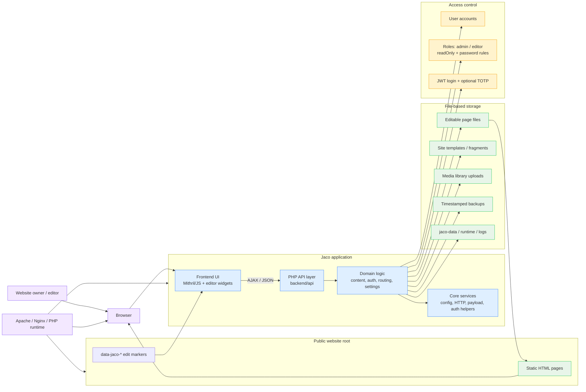

# Jaco CMS Architecture Overview

This project is a flat-file CMS: the public site remains static HTML, while the Jaco application manages editable regions, user accounts, media, templates, and backups without a database.

## How it fits together

- The public site is plain HTML and remains portable and static.
- Jaco marks editable regions with `data-jaco-*` attributes, which the frontend reads and edits inline.
- The PHP backend exposes JSON APIs for page content, media, settings, templates, and user actions.
- The domain layer handles business rules such as authorization, backup creation, and page updates.
- Files on disk become the system of record: pages, templates, media, and backups are stored in the filesystem instead of a database.
- The web server serves the public site and routes requests to the Jaco application, which protects internal/admin areas and manages content.

## Key design characteristics

- Flat-file architecture: no database required.
- Inline editing directly on the live site.
- Backup-first change flow: each mutation keeps a timestamped backup.
- Role-based access control for admin/editor behavior.
- PHP-based runtime with the application living beside the website content.
