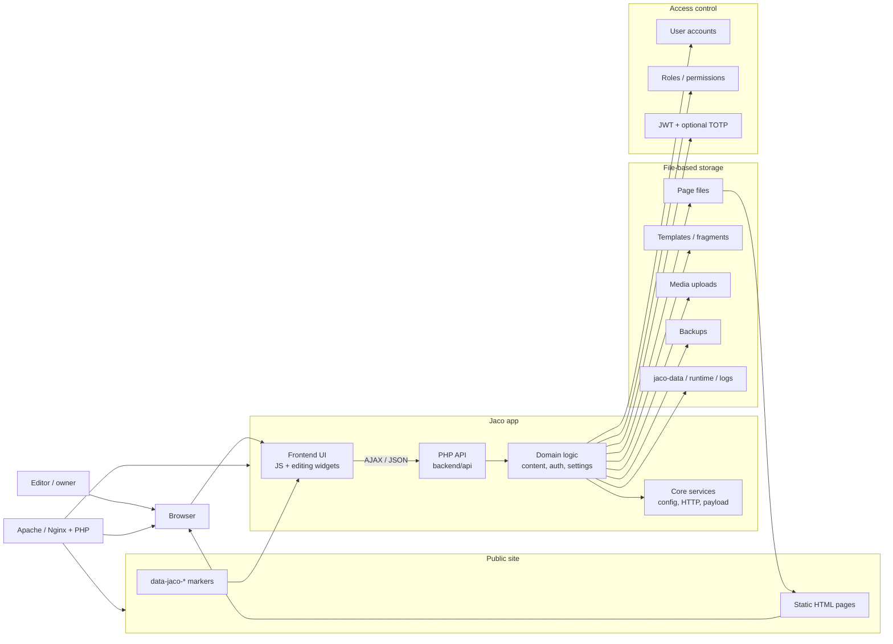
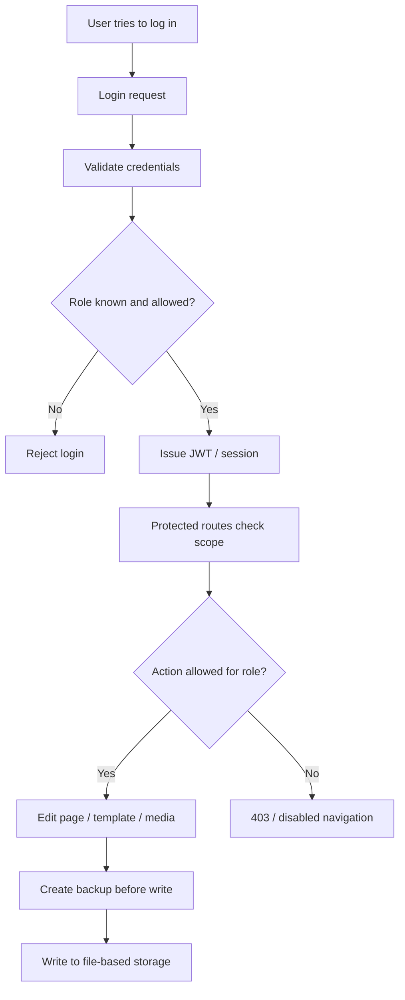
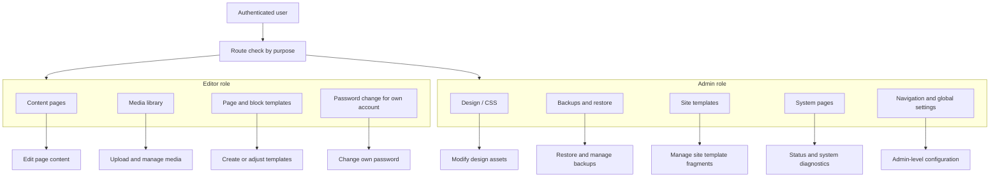
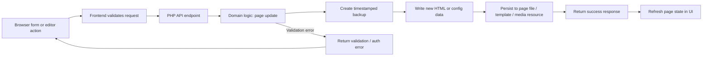
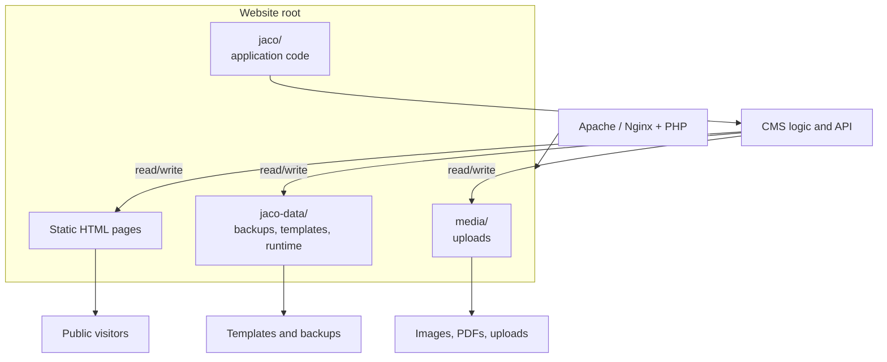
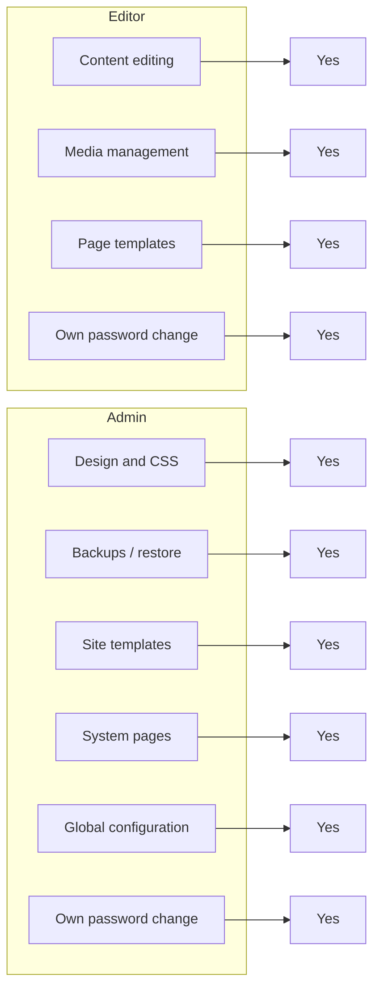

# Jaco CMS Architecture Overview

This document is intentionally a system overview, not a second installation guide or feature reference. It complements the rest of the docs in `docs/` by showing how the main runtime parts fit together and where the role and write boundaries sit.

## 1) System overview

## 2) Authentication and authorization flow

This flow shows the decision path after login: the role is checked before a session is granted, and route-level permission checks determine whether a write is allowed.

## 3) Permission split by feature area

This reflects the reduced role model: editors can handle content workflows, while administrators keep system, design, backup and global configuration responsibilities. Both roles may change their own password.

## 4) Page save flow with automatic backups

The write path is intentionally safety-first: a backup is created before the new content is written to disk.

## 5) File-system and deployment layout

This layout shows the split between the public site and the private CMS workspace. The application and the editable data live beside the site, but are separated from normal public browsing by design.

## 6) Role capability matrix

This is a compact summary of who can do what. It complements the more operational diagrams without repeating the installation or feature documentation already present elsewhere in `docs/`.

## Scope and boundaries

This page is intentionally narrow in scope:

- it explains how the moving parts fit together
- it highlights permission boundaries and write safety
- it visualizes the static-site + CMS split

It does not repeat the installation, contributor workflow, or product feature guides already covered in the rest of the documentation.
