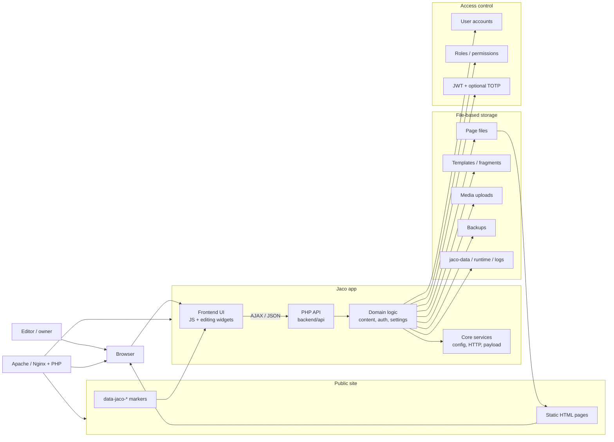

# Jaco CMS Architecture Overview

Jaco keeps the public site as static HTML while the Jaco application handles inline editing, media, templates, backups, and roles. The website files stay portable and versionable, and the PHP backend manages the editing workflows through file-based storage instead of a database.

## Core runtime

- The public site remains plain HTML and can be served from a normal static hosting setup.
- Markers such as `data-jaco-*` identify editable regions that the frontend can manipulate inline.
- The PHP backend exposes JSON endpoints for page content, settings, templates, media, and system actions.

## Storage and business logic

- The domain layer applies the CMS rules: backups before updates, role checks, and page/settings workflows.
- Page files, templates, media, and backups are stored on disk rather than in a database, which keeps the system portable and easy to version.
- Access control is enforced through user accounts, roles, and JWT-based login with optional second-factor authentication.
