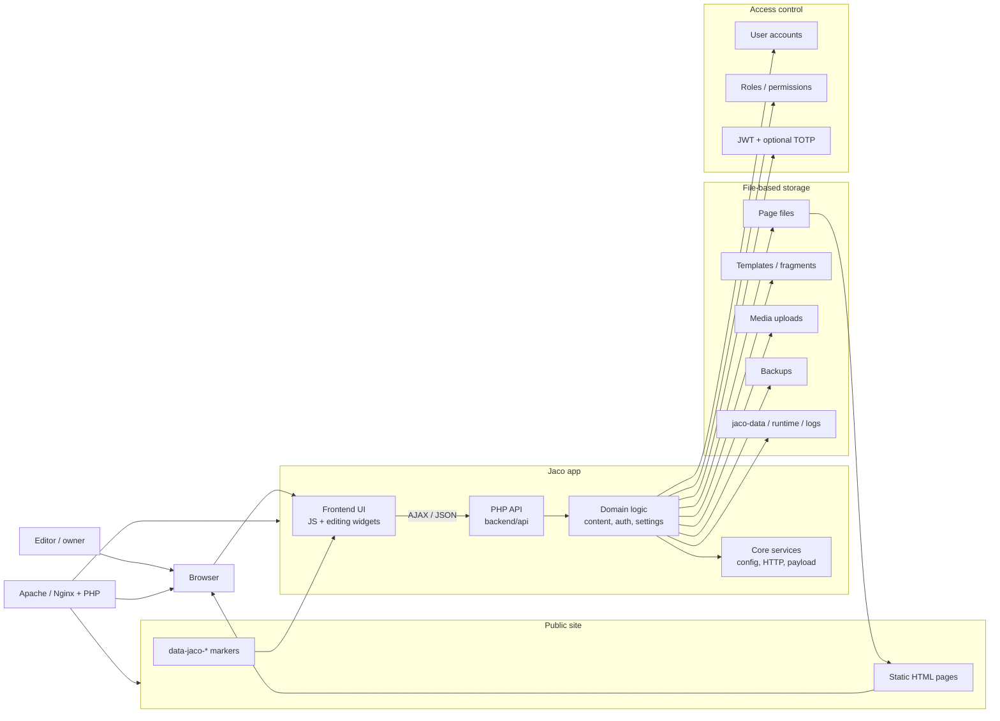
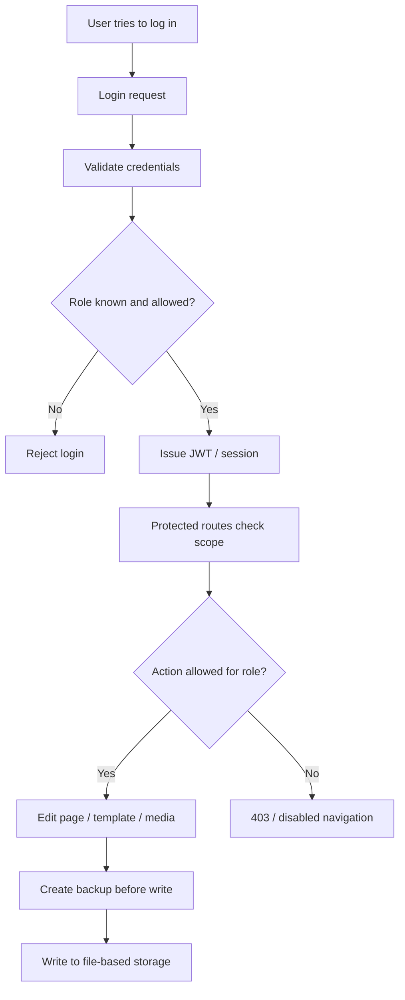
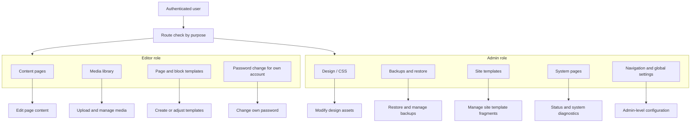
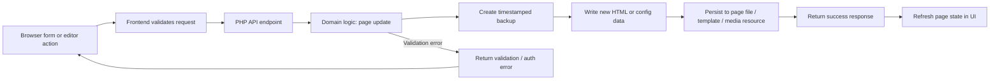
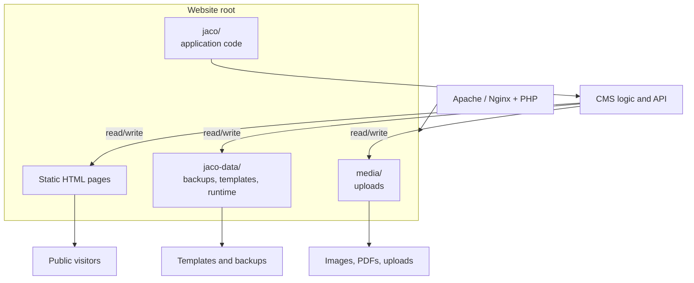
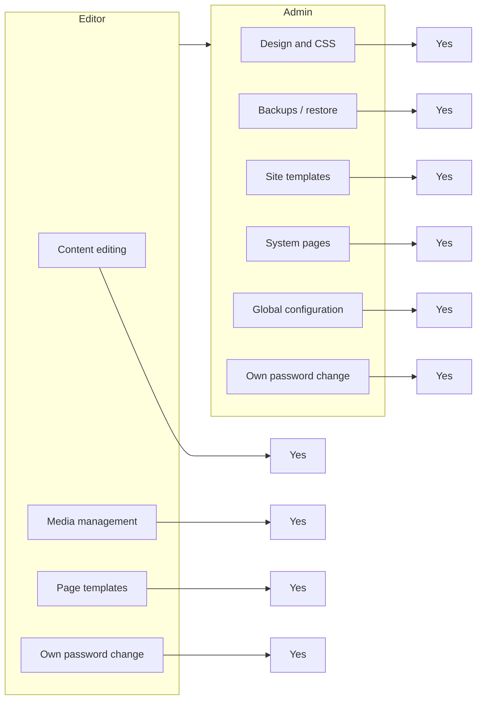

# Jaco CMS Architecture Overview

Jaco keeps the public site as static HTML while the Jaco application handles inline editing, media, templates, backups, and roles. The website files stay portable and versionable, and the PHP backend handles the editing workflows through file-based storage instead of a database.

## 1) System overview

## 2) Authentication and authorization flow

This diagram focuses on the user-access path: credentials are validated, the role is checked, a JWT/session is issued, and each protected action is gated by permission checks before any write is committed.

## 3) Permission split by feature area

This diagram reflects the role split described in the project: editors can work on content and templates, while administrators retain design, backup, system, and template-management access. Both roles can change their own password, but only the relevant role receives access to a given feature group.

## 4) Page save flow with automatic backups

This is the operational core of the CMS: every write is treated as a state-changing action, so the backup step happens before the file is updated.

## 5) File-system and deployment layout

This layout highlights the separation between the public static site and the private CMS workspace: the application and the editable data live next to the site, but they are intentionally kept outside the normal public browsing flow.

## 6) Role capability matrix

This view makes the role model explicit: the editor has focused content and media permissions, while the admin keeps the broader system and design responsibilities. Both can manage their own account password, but no role receives access to areas outside its purpose.

## Core runtime summary

- The public site remains plain HTML and can be served from a normal static hosting setup.
- Markers such as `data-jaco-*` identify editable regions that the frontend can manipulate inline.
- The PHP backend exposes JSON endpoints for page content, settings, templates, media, and system actions.
- The domain layer applies CMS rules: backup creation before writes, role checks, and page/settings workflows.
- Page files, templates, media, and backups are stored on disk rather than in a database, which keeps the system portable and easy to version.
- Access control is enforced through user accounts, roles, and JWT-based login with optional second-factor authentication.
