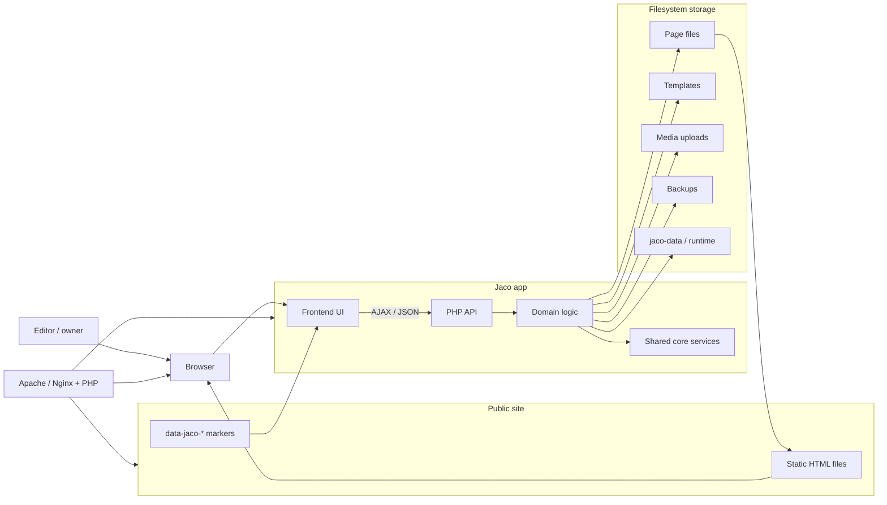
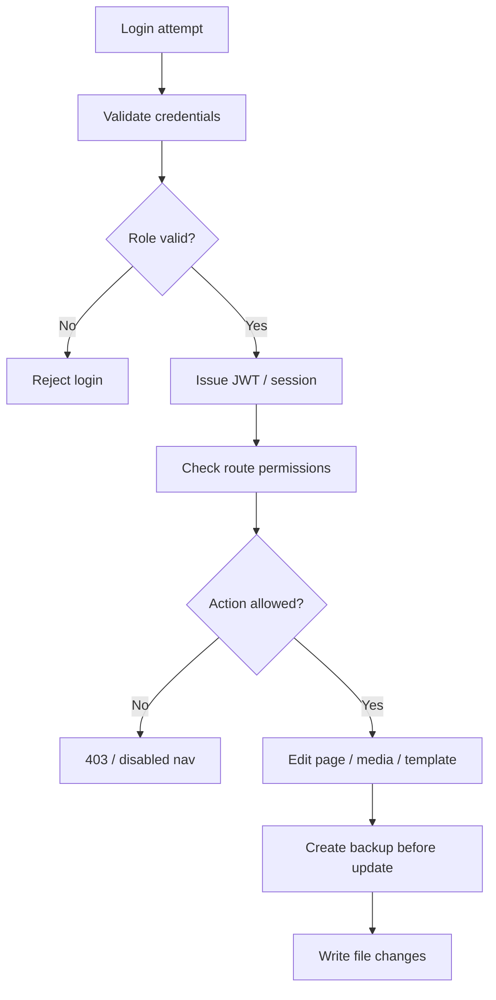
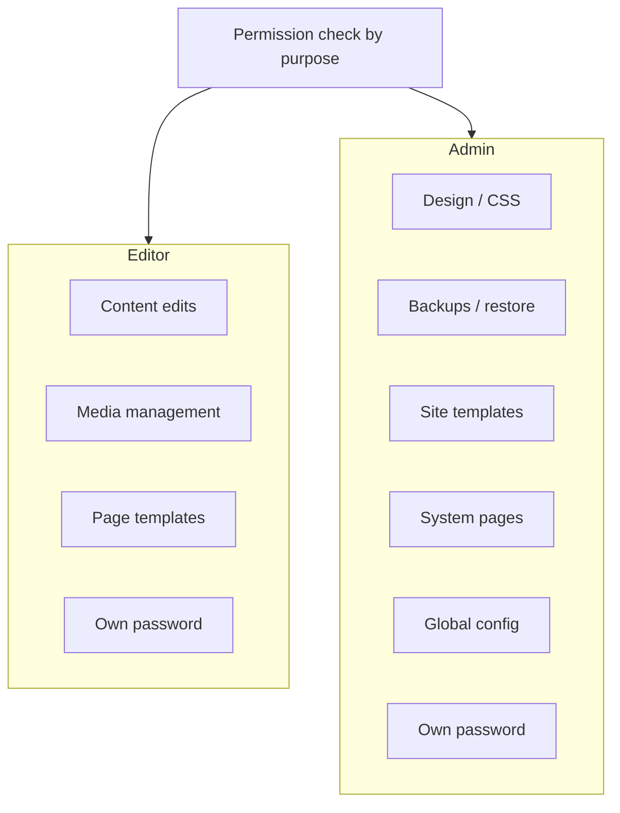
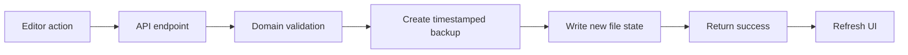
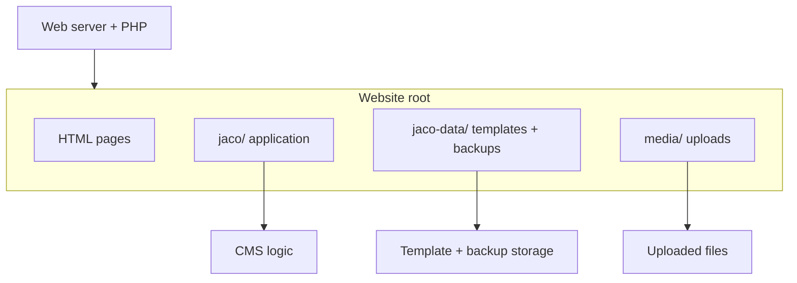

# Jaco CMS Architecture Overview

This document is a system overview for the Jaco CMS. It complements the rest of the documentation in `docs/` by showing the runtime structure, the permission model, and the write path without repeating installation, feature, or development guidance.

## Runtime structure

Jaco keeps the public site as plain HTML while the application handles inline editing, media files, templates, backups, and account access. The PHP backend and domain layer work on top of a file-based storage model, rather than a database.

## Authentication and authorization flow

The role is part of the authentication boundary: an unknown or missing role is not silently downgraded. The route layer then decides whether the user can execute a particular action.

## Role split

The system reduces access to two main roles. Editors work on content and media flows, while administrators retain design, backup, template, and system-level capabilities. Both roles can update their own password.

## Write path and backup safety

Every write is treated as a state-changing operation. A backup is created before the new file state is persisted, which keeps content recovery straightforward and reduces accidental loss.

## File-system layout

This layout separates public-facing static HTML from the private CMS workspace: application code, backups, templates, and uploads remain in structured directories next to the site rather than in a database server.

## Scope boundary

This document intentionally covers:

- runtime composition
- login and authorization flow
- role-based feature boundaries
- backup-before-write behavior
- filesystem layout

It intentionally does not duplicate:

- installation steps
- contributor workflow
- feature-by-feature product documentation
- menu structure
- glossary or constraints material already covered elsewhere in `docs/`
